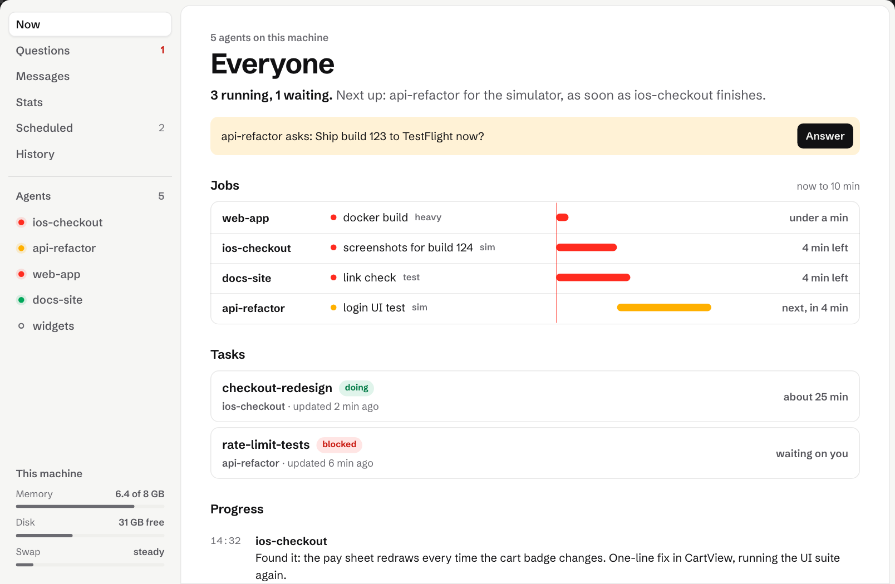

# dibs

Air traffic control for your coding agents.

You run several AI coding agents at once (Claude Code, Codex, Cursor, Gemini CLI) on one computer. They don't know about each other. One reinstalls an app in the iPhone simulator while another is halfway through testing it, and four builds at once run the machine out of memory. dibs makes them take turns on the things only one of them can use at a time, lets them message each other and you, and only asks you the questions that can't be undone.

<picture>
  <source media="(prefers-color-scheme: dark)" srcset="docs/images/dibs-page-dark.png">
  
</picture>

## Install

```bash
curl -fsSL https://dibs.cc/install.sh | sh    # or: npm i -g @dibssoftware/dibs
dibs guard install                            # Claude Code agents use dibs without being told
```

macOS and Linux, with Node 22.23.4 or newer. No sudo and no dependencies. The install also tells your agents dibs is there: it writes their instructions to `~/.dibs-cli/dibs.md` and adds a short note pointing at it to `~/.claude/CLAUDE.md` and Codex's `AGENTS.md`.

## What your agents do with it

An agent puts `dibs run` in front of anything that would collide. It waits for its turn and hands it on the moment the command ends, however it ends. Everything else still runs at once.

```bash
dibs run test -- npm test                      # wait for a turn at the test runner, then run the tests
dibs run sim -- ./ui-test.sh                   # the iPhone simulator, one agent at a time
dibs                                           # the board: who has what, who's next, how much memory is left
dibs tell web-app "use the staging database"   # a message that reaches that agent on its next step
dibs question "Ship build 123?" --options yes,no --recommend yes --one-way "testers get it at once"
```

The last line is the only kind of question that reaches you. Agents decide anything that can be undone themselves, and dibs keeps a record of who did what.

With `dibs guard install`, an agent that forgets gets turned away with the exact `dibs run` line to use instead. Nothing is approved on your behalf.

## What you get

- **The board.** Plain `dibs` says who has what and who's next, in sentences.
- **A page for you.** Every agent's jobs, progress posts, questions and alerts, live, at `http://127.0.0.1:7421` (`dibs web`). You can move a job up, pause, resume or stop it from there.
- **On your phone.** `dibs connect` opens the same page on a phone or any browser, end to end encrypted, or through a dibs account that sees all your machines.
- **Messages.** One thread per agent. You write to an agent and it reads it on its next step; agents write to each other the same way. `dibs listen` wakes an idle agent the moment a message arrives.
- **Questions only when it can't be undone.** An agent asks with its recommendation and keeps working. You answer from the page, the Mac app or the terminal.
- **Alerts with the fix.** When something goes wrong (a long wait, a stuck job, memory holding work back, a full disk), dibs says what and the one thing to do about it.
- **Your own Claude can see it.** The page is also an MCP server, so you can ask Claude "what are my agents doing?".
- **More than one machine.** Add another computer with `dibs connect --machine`, and agents send work to whichever machine is free.
- **A Mac app.** The board in your menu bar: [dibs.cc/mac](https://dibs.cc/mac).

## Learn more

- [dibs.cc](https://dibs.cc)
- [docs/reference.md](docs/reference.md): every command, the rules to paste into your agents' instructions, exit codes, settings
- [docs/](docs/): how turns are decided, the guard, questions, scheduled runs, private simulators, file locks, more machines, the relay

## Details

**Install.** `install.sh` downloads the release from dibs.cc and checks its sha256 before installing anything, puts dibs in `~/.dibs-cli` and links `~/.local/bin/dibs`. If anything fails, it says what and installs nothing. Each release is at `https://dibs.cc/releases/dibs-v<version>.tar.gz`, with its `.sha256` beside it. A pinned version from GitHub: `curl -fsSL https://raw.githubusercontent.com/dibssoftware/dibs/v0.0.180/install.sh | sh`. From a clone: `DIBS_SOURCE=<the clone> sh install.sh`.

**Windows.** From PowerShell, no admin rights needed: `irm https://dibs.cc/install.ps1 | iex`. It checks the sha256 the same way, puts dibs in `~\.dibs-cli`, and makes `dibs.cmd` (PowerShell and cmd) and `dibs` (Git Bash, where Claude Code runs its commands on Windows) in `~\.local\bin`.

**Node.** 22.23.4, 24.22.1, 26.12.1 or newer. Older builds of those lines have the Brotli decoder hole (CVE-2026-111497), and dibs's services refuse to install on them.

**Your agents' notes.** The install writes `~/.dibs-cli/dibs.md` (the agent instructions for this version) and a short marked note pointing at it to `~/.claude/CLAUDE.md`, to `~/.codex/AGENTS.md` if you use Codex, and to the `CLAUDE.md` and `AGENTS.md` of the git repo you ran it in, if those exist. The note sits between `<!-- dibs:start -->` and `<!-- dibs:end -->`, and an upgrade rewrites only those lines. `dibs init` does it by hand (`--repo` also makes this repo's `CLAUDE.md`), `dibs init --remove` takes it out, and `DIBS_NO_AGENT_NOTES=1` before the install line skips it.

**The Claude Code plugin.** Instead of `dibs guard install`, in a Claude Code session: `/plugin marketplace add dibssoftware/dibs`, then `/plugin install dibs@dibs`. Codex reads the same plugin ([docs/guard.md](docs/guard.md)).

**Upgrade** by running the install line again (or `npm i -g @dibssoftware/dibs`), then `dibs guard install` again. Your queue and settings in `~/.dibs` stay.

**Uninstall:**

```bash
dibs init --remove                               # dibs.md, and the dibs note in CLAUDE.md and AGENTS.md
dibs guard remove
dibs service remove serve worker throttle web    # only the ones you installed
rm -rf ~/.dibs-cli ~/.local/bin/dibs ~/.dibs     # ~/.dibs is the queue, history and settings
```

**Words dibs uses.** A *resource* is something agents take turns on: `test`, `sim`, `xcode-build`, `playwright`, `deploy`, `heavy`, or a name you make up. A *turn* lasts exactly as long as the command. A *hold* (`dibs hold sim --for 20m`) keeps a turn across several commands. A *lease* on files (`dibs hold 'files:src/auth/**'`) keeps other agents' edits off them.

**Platforms.** macOS and Linux run the full suite in CI on every push. Windows works, with gaps (no pausing or measuring yet): [the list](docs/windows.md).

## License

dibs is free to use, change and share under the [GNU Affero General Public License v3](LICENSE) (AGPL-3.0-only), at home or at work. If you ship a changed dibs, or run one for other people over a network, the AGPL says you share your changes under the same license.

If your company can't use AGPL software, or you want to build dibs into something you don't open source, buy a commercial license from Creayo LLC: licensing@dibs.cc.

Contributions are welcome: [CONTRIBUTING.md](CONTRIBUTING.md). Before your first pull request is merged you sign a contributor license agreement, which lets Creayo LLC offer your change under both licenses.
